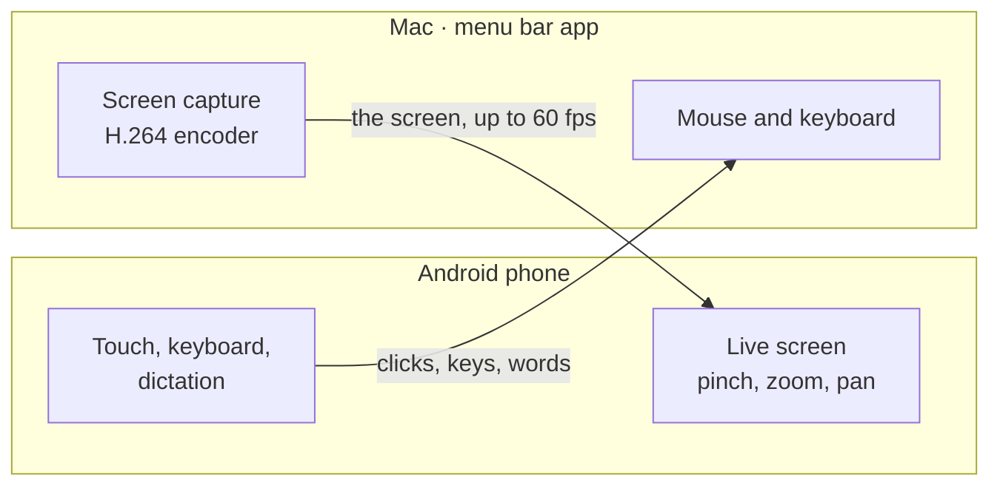
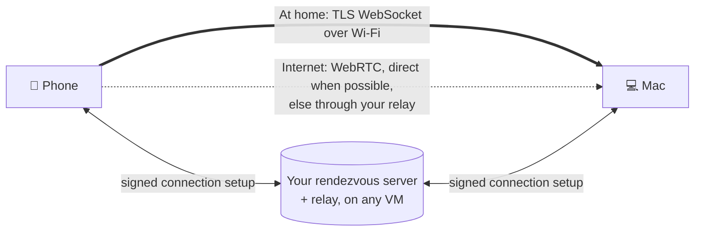

# Longarm

**Your Mac, from your Android phone.** Longarm shows your Mac's screen live on your phone and turns
the phone's taps, keys and voice into the Mac's mouse and keyboard: at home over Wi-Fi, or from
anywhere over the internet through a small server you run yourself.


It's two apps that pair with a QR code: a menu bar app on the Mac (Swift) and an Android app
(Kotlin, Compose). There's no account, no cloud service and no third party between them.

> **Status:** early, and built for developers: you build both apps from source (see
> [Getting started](docs/getting-started.md)). macOS 15+ on Apple silicon, Android 8+.



## What it does

- **Live screen:** the whole Mac display, hardware H.264 on both ends, full screen and landscape on
  the phone. Pinch to zoom, drag to look around.
- **Touch is the mouse:**

  | On the phone | On the Mac |
  |---|---|
  | Tap | click |
  | Tap twice | double-click |
  | Two-finger tap, or the **R** button | right-click (there, or where the pointer is) |
  | Long-press, then drag | click-and-drag: select text, move windows |
  | One- or two-finger drag | scroll |
  | Three fingers up / down / sideways | Mission Control / app windows / next Space |

- **Keyboard:** a see-through keyboard over the picture. ⌘ ⌥ ⌃ ⇧ turn the next key into a
  shortcut, and there are buttons for the common ones (⌘+ / ⌘−, esc, tab, arrows, ⌘⇥, Spaces,
  leaving full screen). The keyboard button shows an orange dot when the Mac has a text field
  focused, and a lock for a password field, so you know where typing will land.
- **Dictation:** 🎤 on the keyboard streams the phone's microphone to the Mac, which turns it into
  text with [Deepgram](https://deepgram.com) (bring your own key); ↵ types it on the Mac.

## At home or over the internet

You pick how the phone connects, on both devices. It never quietly falls back from one to the other.



- **At home:** phone and Mac on the same Wi-Fi (or USB with `adb reverse`). Nothing else needed.
- **Over the internet:** WebRTC between the two, end-to-end encrypted. They find each other through
  a rendezvous server you host (`server/`, installed with `deploy/` on any small VM); it never sees
  your screen or what you type. A join code you set on the Mac is asked for on top of pairing.
  See [Internet connections](docs/internet.md).

## Security in short

- Remote control is **off until you allow it** in the Mac's menu, and the menu bar shows an orange
  **Remote** while a phone is in control. It stops after 10 minutes without input.
- Only a paired phone gets in: a random secret from the QR code, and the phone pins the Mac's TLS
  certificate. Over the internet, both devices also sign everything with keys held in the Mac's
  Secure Enclave and the Android Keystore, and the phone needs the join code.

The details, including what each part can and can't see and the known limits, are in
[Security](docs/security.md).

## Quick start

```bash
git clone https://github.com/OlusanyaAyomide/longarm.git && cd longarm
mac/build.sh --run          # builds and opens the Mac app (fetches WebRTC, ~70 MB, the first time)
android/deploy.sh           # builds and installs the phone app over adb
```

Then: allow Accessibility and Screen Recording when macOS asks, choose **Pair a Phone…** in the
Longarm menu, scan the QR code with the phone, turn on **Allow Remote Control**, and tap **Control
your Mac**. The full walk-through is in [Getting started](docs/getting-started.md).

## Documentation

| | |
|---|---|
| [Getting started](docs/getting-started.md) | Building both apps, permissions, pairing, the menu |
| [Internet connections](docs/internet.md) | How it works, and hosting your own server and relay |
| [Security](docs/security.md) | The security model, what's stored where, known limits |
| [Architecture](docs/architecture.md) | How the pieces fit, the video pipeline, the message protocol |
| [Troubleshooting](docs/troubleshooting.md) | Common problems, and where the logs are |
| [Contributing](CONTRIBUTING.md) | Building, testing, code style |
| [deploy/README](deploy/README.md) | The server install, step by step |

## Roadmap

- Prebuilt downloads (a release APK; a signed and notarized Mac app).
- Voice control of the Mac: say what you want done, from the phone or the Mac.

## License

MIT, see [LICENSE](LICENSE). Found a security problem? See [SECURITY.md](SECURITY.md).
