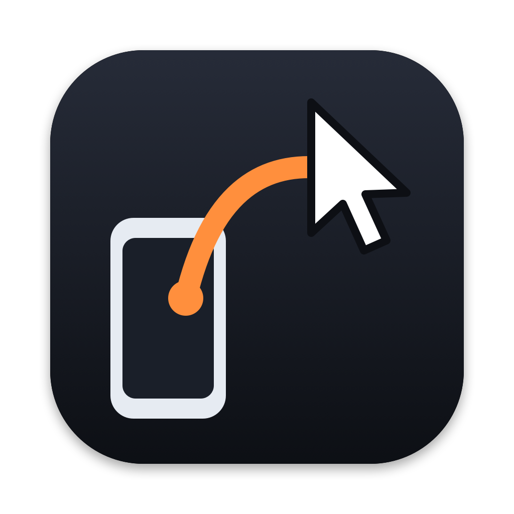

# Longarm

**Your Mac, from your phone.** Longarm shows your Mac's screen live on an Android phone and turns
the phone's touches, keys and voice into the Mac's mouse and keyboard. A small menu bar app on the
Mac, an Android app on the phone, paired with a QR code, talking directly over your network.



## What it does

- **Live screen:** the whole Mac display at up to 60 fps, hardware H.264 on both ends (usually
  1–3 KB a frame), full screen and landscape on the phone. Pinch to zoom, drag to look around.
- **Touch is the mouse:**

  | On the phone | On the Mac |
  |---|---|
  | Tap (quick or slow) | click |
  | Tap twice | double-click |
  | Two-finger tap | right-click there |
  | **R** button | right-click where the Mac's pointer is |
  | Long-press, then drag | click-and-drag (select text, move windows) |
  | One-finger drag | scroll (moves the view instead when zoomed in) |
  | Two fingers moving together | scroll |
  | Pinch | zoom the picture |
  | Three fingers up / down / sideways | Mission Control / app windows / next Space |

- **Keyboard:** a see-through keyboard over the picture (drag it up or down, adjust its blur),
  keys sent as you tap with a buzz and a flash. ⌘ ⌥ ⌃ ⇧ on the side turn the next key into a
  shortcut; buttons for ⌘+ / ⌘− / ⌘0, esc, tab, arrows, ⌘⇥, ⌘␣, Mission Control, Spaces and
  leaving full screen.
- **Dictation:** 🎤 on the keyboard streams the phone's microphone to the Mac, which runs it
  through a speech-to-text service (Deepgram); the words collect in a box on the keyboard and ↵
  types them on the Mac.

## At home or over the internet

You choose how the phone connects, on both ends; it never falls back from one to the other.

- **At home:** phone and Mac on the same Wi-Fi (or USB with `adb reverse`). Switched on in the
  Mac's menu under *Connect from → Home Wi-Fi*, and picked on the phone with **At home**.
- **Over the internet:** WebRTC between the phone and the Mac, directly when the two networks
  allow it, otherwise through a TURN relay, end-to-end encrypted either way. They find each other
  through a small rendezvous server you run yourself (`server/`, installed on any VM with
  `deploy/`). On the Mac choose *Internet Server…* and turn on *Internet*, with a **join code**
  (6–12 digits). Pair the phone with the QR code or pairing link, which then carry the Mac's key
  and server, so it can pair from anywhere; then pick **Internet** on it. It asks for the code,
  and again only after 10 minutes away.

## Safety

- Remote control is **off until you allow it** in the Mac's menu (Allow Remote Control).
- Only a phone that scanned the Mac's QR code can connect: a random token, and the phone pins the
  Mac's self-signed TLS certificate. Reset Pairing in the menu revokes every phone.
- Over the internet, every connection offer is signed with keys the phone and Mac swapped at home
  (the Mac's in its Secure Enclave, the phone's in the Android Keystore), so the rendezvous server
  can pass them along but can't read, forge or redirect them; it never sees the screen or input.
- The phone also needs the join code. The Mac keeps only a salted PBKDF2 hash of it in the
  Keychain; five wrong codes in a row lock internet joins for 15 minutes. After the right code
  the phone holds a ticket that the Mac honours until it goes 10 minutes unused.
- The home listener only accepts connections from the Mac's own network, not over a VPN.
- While a phone is in control, the Mac's menu bar shows an orange **Remote** (Stop is in its
  menu), and a notice appears on screen when it starts.
- It stops when the phone disconnects and after 10 minutes without input. The Mac's display and
  the phone's screen stay awake only while it's on.

## Build and run

Requirements: macOS 15 or later on Apple silicon (Xcode command line tools for `swiftc`), an
Android 8+ phone, and Android Studio (or a JDK 17 with the Android SDK).

**Mac**

```bash
mac/build.sh --run
```

Builds `mac/build/Longarm.app` and opens it in the menu bar. On first use macOS asks for:

- **Accessibility** (System Settings → Privacy & Security → Accessibility → Longarm): to click
  and type for the phone.
- **Screen & System Audio Recording**: to show the screen. macOS may ask you to quit and reopen.

The build is signed with your Apple Development identity if you have one, so these permissions
survive rebuilds (set `LONGARM_SIGN_IDENTITY` to choose; ad-hoc signing works but asks again on
every build). For dictation, add a Deepgram API key from the menu; it's kept in your Keychain.

**Phone**

```bash
android/deploy.sh
```

Builds and installs over `adb` (USB or Wireless debugging), or open `android/` in Android Studio.
Then on the Mac choose **Pair a Phone…**, scan the code with the app, allow remote control in
the Mac's menu, and tap **Control your Mac**.

## How it works

```
Phone (Kotlin, Compose)                          Mac (Swift, menu bar)
  RemoteUi  — gestures, keyboard ──JSON──▶  LinkServer ─▶ RemoteControl ─▶ InputInjector (CGEvent)
  VideoDecoder (MediaCodec) ◀── H.264 ────  ScreenShare ◀ ScreenCapture (ScreenCaptureKit)
                                                          ◀ VideoEncoder (VideoToolbox)
  PhoneMic ──────────── PCM ────────────▶  PhoneDictation ─▶ SpeechEngine (Deepgram)
```

At home, one TLS WebSocket (port 47900, found over Bonjour as `_longarm._tcp`) carries JSON messages and
binary frames; the full list is at the top of `mac/Sources/RemoteControl.swift`. Video keeps the
latency low: the encoder never reorders frames, a busy link skips ahead to the next key frame
instead of queueing, and a still screen is re-sent a few times so text sharpens.

Over the internet the same messages go over a WebRTC data channel and the screen is a WebRTC
video track (`InternetLink` on both sides), set up through the rendezvous server
(`RendezvousClient` on the Mac). WebRTC is Google's, as built by LiveKit: `mac/fetch-webrtc.sh`
downloads it (checksum-verified) on the first Mac build, and Gradle fetches it for the phone.

The parts are behind small interfaces so they can be swapped: `InputInjector` (how input is
delivered), `StreamingTranscriber` / `SpeechEngine` (speech-to-text).

## Roadmap

- An AI agent on the phone that operates the Mac through named actions ("open Terminal and run…"),
  with screen reading for the rest.

## License

MIT, see [LICENSE](LICENSE).
