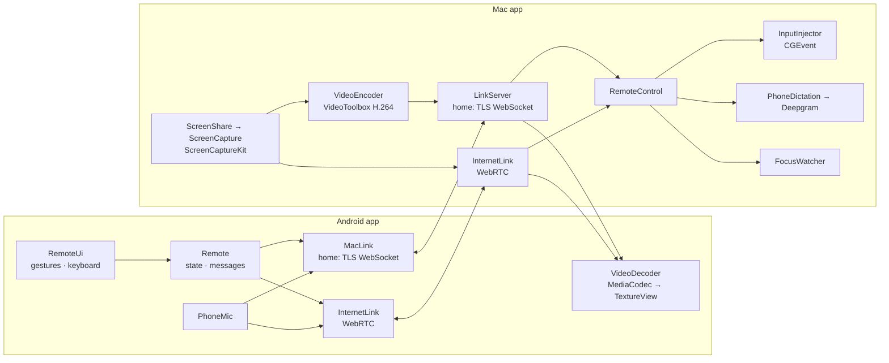
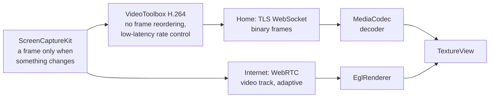
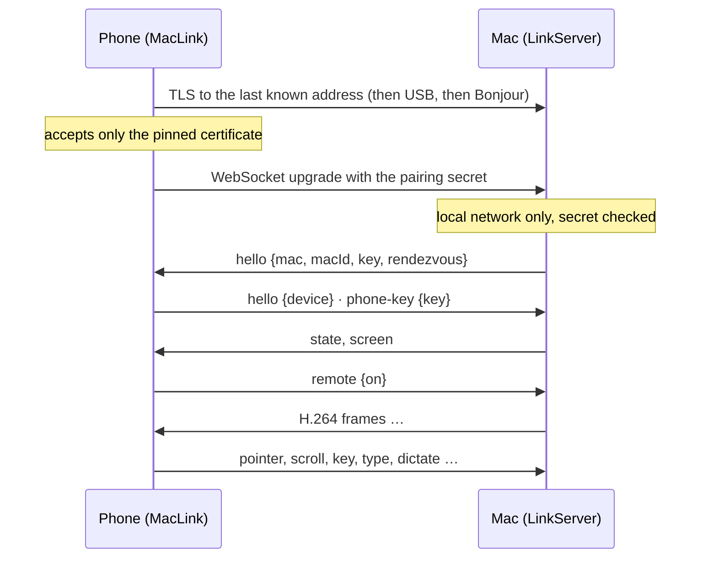

# Architecture

How the pieces fit, for anyone reading or changing the code. Each source file starts with a comment
saying what it's for; this page is the map.

## The repository

| Folder | What | Built with |
|---|---|---|
| `mac/` | The menu bar app | Swift, AppKit, ScreenCaptureKit, VideoToolbox; `swiftc` via `mac/build.sh` (no Xcode project) |
| `android/` | The phone app | Kotlin, Jetpack Compose, MediaCodec, OkHttp; Gradle |
| `server/` | The rendezvous server, for internet connections | TypeScript on Node 22.6+, run without a build step; one dependency (`ws`) |
| `deploy/` | Installing the server and relay on a VM | Bash, systemd, coturn, nginx or Caddy |

WebRTC (internet connections only) is Google's, as built and published by LiveKit:
`mac/fetch-webrtc.sh` downloads it for the Mac, Gradle fetches it for the phone.

## Components

**Mac**

| Part | Files |
|---|---|
| Menu, settings, wiring | `AppDelegate.swift` |
| Home link: TLS WebSocket server, Bonjour, local-network check | `LinkServer.swift`, `LocalNetwork.swift`, `Pairing.swift` |
| Internet link: WebRTC sessions, rendezvous client, device keys, join code | `InternetLink.swift`, `RendezvousClient.swift`, `DeviceKey.swift`, `JoinCode.swift` |
| Remote control: messages from the phone, input, keep-awake | `RemoteControl.swift`, `RemoteInput.swift` |
| The screen: capture, encoding | `ScreenShare.swift`, `ScreenCapture.swift`, `VideoEncoder.swift`, `ScreenRegion.swift` |
| Dictation | `PhoneDictation.swift`, `Speech.swift`, `StreamingTranscriber.swift`, `DeepgramTranscriber.swift` |
| What has keyboard focus | `FocusWatcher.swift` |

**Phone**

| Part | Files |
|---|---|
| Screens: pairing, home, remote control | `MainActivity.kt`, `RemoteUi.kt`, `Theme.kt` |
| Remote-control state and messages | `Remote.kt`, `PhoneMic.kt`, `VideoDecoder.kt` |
| Home link, reconnecting, Bonjour | `MacLink.kt`, `Discovery.kt`, `LinkService.kt` |
| Internet link | `InternetLink.kt`, `DeviceKey.kt`, `SecretStore.kt` |
| Pairing | `Pairing.kt` |

## The screen, end to end

Video is where latency comes from, so both paths keep frames moving rather than queueing them.

- **At home** the Mac encodes H.264 itself. A busy link doesn't build a queue: after a few waiting
  frames it skips ahead to the next key frame. A screen that's gone still is re-sent a few times so
  the encoder can sharpen it. Off Wi-Fi the phone asks for a lighter stream (30 fps, smaller).
- **Over the internet** raw frames go to WebRTC, which encodes and adapts to the link by itself
  (up to 1920 pixels, 30 fps); the still frame is repeated so it can answer requests for key frames.

## Connecting at home

Internet connections are described in [Internet connections](internet.md).

## Messages

JSON objects with a `type`, the same at home and over the internet (where they travel on a WebRTC
data channel); the full reference is at the top of `mac/Sources/RemoteControl.swift`.

| Phone → Mac | |
|---|---|
| `remote {on}` | start or stop remote control |
| `pointer {action, x, y, button, count}` | click, or drag-start / drag-move / drag-end; `x`, `y` are 0–1 of the screen, or left out for where the pointer is |
| `scroll {x, y, dx, dy}` | scroll at a point |
| `key {key, modifiers}` · `type {text}` | a key or shortcut · text to type |
| `dictate {on}`, then binary `0x03` + 16 kHz mono PCM | dictation |
| `keyframe` · `quality {light}` | the decoder needs a key frame · the phone is off Wi-Fi |

| Mac → phone | |
|---|---|
| `state {on, allowed, error, focus}` | remote control's state |
| `screen {region, generation}` | what's being shown |
| `focus {kind}` | what has keyboard focus: `none`, `text` or `secure` |
| `dictation {text \| final, done, error}` | words being recognised |
| `notice {text}` | something to tell the user |
| binary `0x02` · generation · key frame · width · height · H.264 | a video frame (home only) |

The link's own messages (`hello`, `phone-key`, `join`, and the rendezvous protocol) are documented at
the top of `LinkServer.swift`, `InternetLink.swift` and `server/src/rendezvous.ts`.

## Where to extend

- **`InputInjector`** (`RemoteInput.swift`): how clicks and keys reach the Mac. `MacInput` posts
  CGEvents; another implementation could target something else.
- **`SpeechEngine` / `StreamingTranscriber`** (`Speech.swift`): speech-to-text. Deepgram is one
  subclass; another service is a new subclass plus a case in `SpeechEngine`.
- **`server/`** is small and self-contained, with tests (`npm test`): a good place to start.
