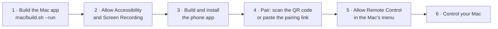

# Getting started

Longarm is built from source for now. This guide takes you from a fresh clone to controlling your
Mac from your phone at home; [Internet connections](internet.md) adds using it from anywhere.



## What you need

| | |
|---|---|
| **Mac** | macOS 15 or later on Apple silicon, with Xcode or its command line tools (`xcode-select --install`) |
| **Phone** | Android 8 or later |
| **To build the phone app** | Android Studio, or a JDK 17+ with the Android SDK; `adb` to install |
| **Optional** | A [Deepgram](https://deepgram.com) API key, for dictation |

## 1. Build and run the Mac app

```bash
mac/build.sh --run
```

This compiles `mac/build/Longarm.app` with `swiftc` and opens it. It lives in the menu bar (no Dock
icon). The first build downloads Google's WebRTC framework, as built by LiveKit, into `mac/vendor/`
(about 70 MB, checked against its published checksum by `mac/fetch-webrtc.sh`).

**Signing.** The build is signed with your Apple Development identity if you have one, which keeps
macOS's permission grants across rebuilds. Choose another with `LONGARM_SIGN_IDENTITY`. Without one
it signs ad hoc, which works, but macOS asks for the permissions again after every build.

## 2. Allow Accessibility and Screen Recording

On first launch Longarm asks for both. They're what remote control is made of:

- **Accessibility**: to click and type for the phone.
- **Screen & System Audio Recording**: to show the screen. macOS may ask you to quit and reopen
  Longarm afterwards.

The Longarm menu shows ✓ for each one granted, or a link to the right Settings page.

## 3. Build and install the phone app

With the phone connected over USB, or over Wireless debugging (Settings → Developer options):

```bash
android/deploy.sh
```

It builds the debug APK, installs it with `adb` and opens Longarm. You can also open `android/` in
Android Studio. To build an APK to share instead:

```bash
cd android && ./gradlew assembleDebug                      # every CPU type, about 44 MB
cd android && ./gradlew assembleDebug -Pabis=arm64-v8a     # current phones only, about 22 MB
```

The APK lands in `android/app/build/outputs/apk/debug/`.

## 4. Pair the phone

On the Mac, choose **Pair a Phone…** in the Longarm menu. On the phone, either:

- tap **Scan QR code** and scan it, or
- copy the Mac's pairing link (**Copy Pairing Link** in the menu) to the phone, and paste it into
  the box on the pairing screen. The box checks it as you paste.

Confirm **Pair with …?** on the phone. A Mac can have several phones; pairing a phone with another
Mac replaces its old pairing.

> The pairing link and QR code contain the pairing secret. Treat them like a password: anyone with
> them can connect while remote control is allowed. **Reset Pairing…** in the menu cancels every
> phone's pairing.

## 5. Allow remote control, and connect

On the Mac, turn on **Allow Remote Control** in the Longarm menu. On the phone, pick **At home**
and tap **Control your Mac**. The Mac's menu bar shows an orange **Remote** while the phone is in
control; **Stop Remote Control** is in its menu.

**Over USB** instead of Wi-Fi, forward the port and the phone finds the Mac by itself:

```bash
adb reverse tcp:47900 tcp:47900
```

## 6. Dictation (optional)

Add a Deepgram key with **Deepgram API Key…** in the Longarm menu (it's kept in your Keychain).
Then 🎤 on the phone's keyboard streams your voice to the Mac; the words collect in a box on the
keyboard and ↵ types them on the Mac.

## The Longarm menu

| Item | What it does |
|---|---|
| **Connect from → Home Wi-Fi (or USB)** | Accept phones on this Mac's own network |
| **Connect from → Internet** | Accept phones over the internet, through your server ([Internet connections](internet.md)) |
| **Internet Server…** | The rendezvous server's address, e.g. `wss://longarm.example.com/v1` |
| **Set / Change Join Code…** | The code phones must give over the internet |
| **Allow Accessibility / Screen Recording…** | Shown until granted |
| **Allow Remote Control** | The master switch: nothing is controlled while it's off |
| **Deepgram API Key…** | For dictation from the phone |
| **Pair a Phone… / Copy Pairing Link** | The QR code, or the same as a link |
| **Reset Pairing…** | A new pairing secret: every phone must pair again |

Next: [use it from anywhere](internet.md), or see [Troubleshooting](troubleshooting.md) if
something doesn't work.
