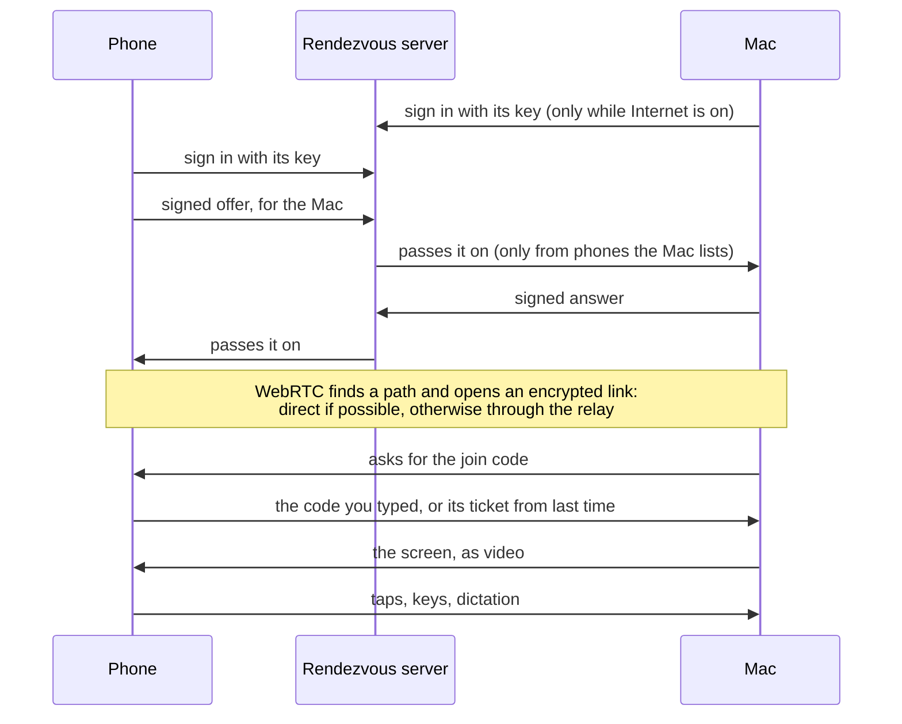
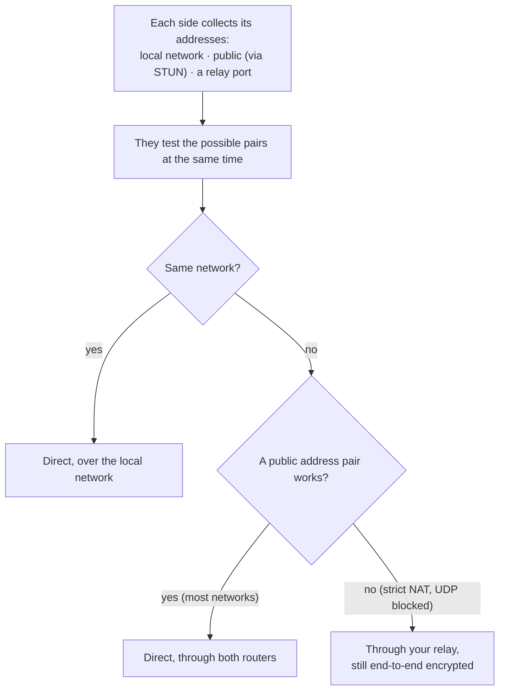
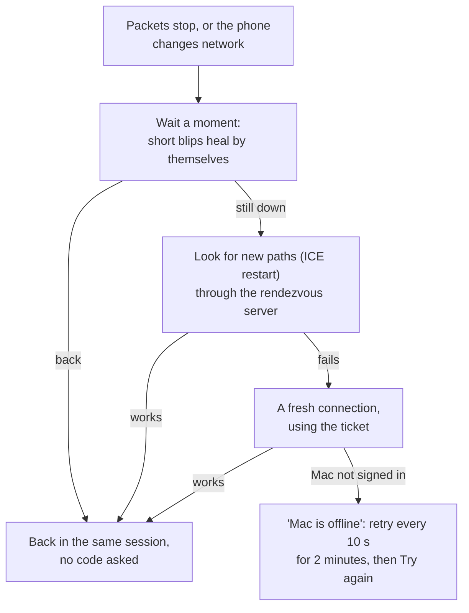

# Internet connections

At home the phone talks to the Mac directly over Wi-Fi. Away from home they use WebRTC, the same
technology as video calls: a direct, end-to-end encrypted connection between the two devices, or,
on networks that won't allow that, one through a relay. To find each other they use a small
**rendezvous server that you host**. Longarm has no default server and no service of its own.

## The pieces

| Piece | Where | What it does |
|---|---|---|
| **Rendezvous server** | `server/` (Node.js, TypeScript), on your VM | Each device keeps a WebSocket to it. It passes their connection setup between them, then steps aside. |
| **Relay (TURN)** | [coturn](https://github.com/coturn/coturn), on the same VM | Carries the connection only when a direct one is impossible: some mobile carriers, strict office Wi-Fi. |
| **The Mac and phone** | `InternetLink` in each app | Sign in to the server, set up WebRTC, and send the screen as a video track and everything else over a data channel. |

The server never sees your screen, input or audio, and it can't forge or redirect a connection:
see [Security](security.md).

## How a connection is made



The server's part ends once the link is open. Both devices stay signed in to it during the session,
which is what makes reconnecting quick.

### Direct or through the relay

WebRTC decides, every time. Each side lists every address it might be reached at, and they try the
pairs at once, best first:



The phone shows **Direct** or **Relay** for a few seconds when the connection is made or its path
changes. A connection that started on the relay moves to a direct path by itself if one appears.

### When the connection drops



The last picture stays on the phone with **Reconnecting…** while this happens. On the Mac, a phone
that drops off keeps its session for a minute; after that, remote control ends.

## The join code

On top of pairing, a phone needs the **join code** you set on the Mac (6–12 digits) to connect over
the internet. After the right code it holds a **ticket**, so it isn't asked again until it's gone
10 minutes unused. Five wrong codes in a row lock internet joins for 15 minutes. Changing the code,
Reset Pairing or quitting Longarm cancels every ticket.

## Setting it up

### 1. Host the server and relay

Any Linux machine with a public address will do; a small cloud VM is plenty (the rendezvous server
uses about 45 MB of memory). Follow [deploy/README](../deploy/README.md): it installs both without
Docker, behind your existing nginx (with certbot) or Caddy, and covers the firewall ports:

| Port | Protocol | For |
|---|---|---|
| 80, 443 | TCP | the rendezvous server, over HTTPS |
| 3478 | UDP and TCP | the relay |
| 49160–49200 | UDP | relayed traffic |

You'll need a name for the machine, such as a subdomain of yours, for the HTTPS certificate.

### 2. Point the Mac at it

In the Longarm menu:

1. **Internet Server…**: `wss://<your name>/v1`
2. **Connect from → Internet**: it asks you to choose a join code the first time.

The menu shows **Ready** once the Mac is signed in to the server.

### 3. Pair the phone, from anywhere

Pair as usual: the QR code or pairing link carries the Mac's key and server address once
**Internet Server…** is set, so the phone doesn't need to be on your Wi-Fi. The pairing box on the
phone says *works from anywhere* for such a link. Then on the phone pick **Internet**, tap
**Control your Mac**, and enter the join code.

A phone paired before the server was set learns it the next time it connects **At home**.

## Trying it without a server

To test on one network before deploying, run the rendezvous server on the Mac:

```bash
cd server && npm ci && HOST=0.0.0.0 PORT=8090 npm start
```

and set **Internet Server…** to `ws://<the Mac's IP address>:8090/v1`. Debug builds of the phone app
accept plain `ws://`; release builds only accept `wss://`. There's no relay this way, so it only
shows the direct path.

## What it costs

The rendezvous server is tiny. The relay's traffic is the only real cost, and only for the minority
of connections that need it: a relayed session carries the screen, usually 1–4 Mbit/s while the
picture changes. coturn is configured to cap each user (4 sessions, 6 Mbit/s each) and the total
(60 sessions at once).
