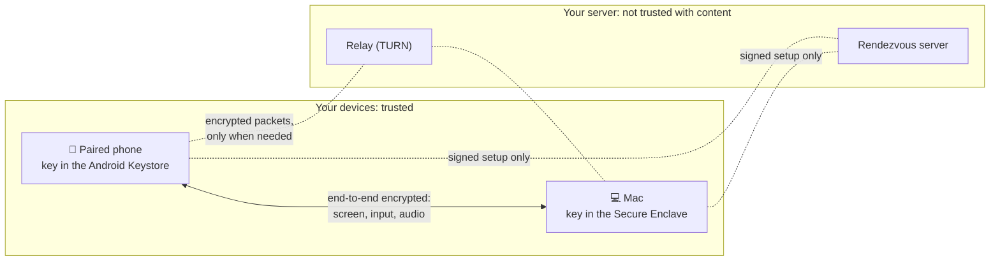
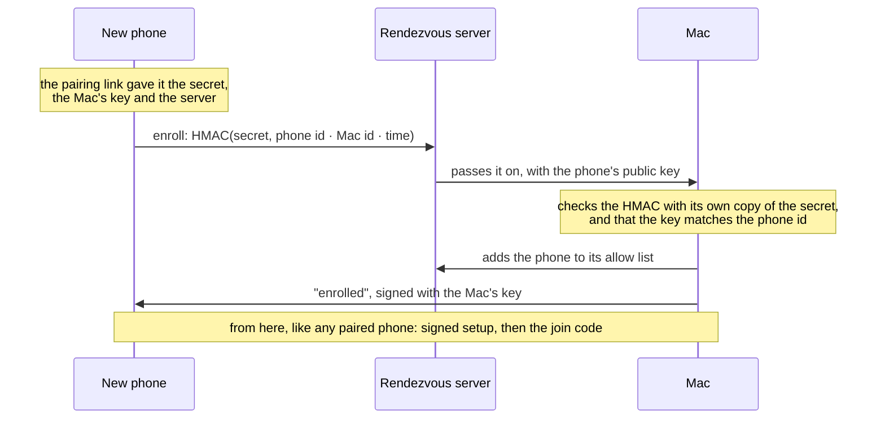

# Security

Longarm lets a phone see your Mac's screen and use its keyboard and mouse, so its security model
matters more than most apps'. This page explains how it decides who gets in, what each part can and
can't see, what's stored where, and the limits we know about. To report a problem, see
[SECURITY.md](../SECURITY.md).

## Who is trusted with what

The server and relay are yours, but the design doesn't rely on them being honest: they pass along
messages they can't read or alter without the devices noticing.

## On the Mac

- **Off by default.** Nothing can be controlled until you turn on **Allow Remote Control**.
- **Visible.** While a phone is in control the menu bar shows an orange **Remote** (with Stop in its
  menu), and a notice appears on screen when it starts.
- **Bounded.** Remote control ends after 10 minutes without input, and when the phone disconnects
  (over the internet, after a minute's grace for it to come back). The display is kept awake only
  while it's on.
- **macOS permissions.** Clicking and typing need Accessibility, and showing the screen needs Screen
  Recording; both are granted by you in System Settings and can be revoked there.

## Pairing and the home link

Pairing hands the phone three things, in the QR code or pairing link:

| | |
|---|---|
| A **pairing secret** | 256 random bits. The phone presents it on every connection; the Mac compares it in constant time. |
| The Mac's **certificate fingerprint** | SHA-256 of the Mac's self-signed TLS certificate. The phone trusts exactly that certificate, so nothing else on the network can pose as the Mac. |
| The Mac's **address and id** | To find it (it's also advertised on the local network over Bonjour). |

At home the connection is a TLS WebSocket (port 47900). The Mac only accepts it from its own network:
loopback (USB through `adb reverse`) or a subnet of one of its own interfaces. Connections arriving
through a VPN are turned away, so "home" really means home.

## Over the internet

### Device keys

Each device has its own long-term P-256 key that can sign but can't be copied off it: on the Mac in
the **Secure Enclave** (a software key in the Keychain on Macs without one), on the phone in the
**Android Keystore** (hardware-backed where the phone supports it). The Mac learns a phone's public
key over the home link, or from its introduction (below); the phone learns the Mac's from pairing.

### The rendezvous server

- **Signing in** is a challenge: the server sends a random nonce, and the device signs it with its
  key. A device's id is the SHA-256 of its public key, so ids can't be claimed without the key.
- **Allow lists:** a Mac tells the server which phone ids may reach it. Anyone else gets
  "unreachable", whether the Mac is online or not.
- **Signed setup:** every offer, answer and network candidate is signed end to end by the sending
  device, names both devices, and carries a timestamp (rejected after 10 minutes). The WebRTC offer
  includes the fingerprint of the device's encryption key, so the server can't put itself in the
  middle of the connection.
- **Limits:** messages up to 64 KB, 240 a minute per connection, 16 connections per IP address, and
  10 seconds to sign in.

**What the server sees:** device ids, IP addresses, when devices connect, and the size and timing of
setup messages. **What it never sees:** your screen, input, audio, the pairing secret or the join
code.

### Pairing from anywhere

A phone paired away from home introduces itself to the Mac with proof that it holds the pairing
secret, without ever sending the secret:

A replayed introduction only re-adds the same phone. After **Reset Pairing**, old links fail.

### The connection itself

WebRTC encrypts everything end to end: the screen (SRTP) and the data channel with input and
dictation (DTLS), keyed by the devices themselves. Through the relay it stays encrypted; the relay
only forwards packets.

### The join code and tickets

- On top of pairing, the phone needs the **join code** (6–12 digits) to connect over the internet.
  It's checked by the Mac, inside the encrypted connection.
- The Mac stores only a **salted PBKDF2-SHA256 hash** of it (100,000 rounds) in the Keychain.
- **Five wrong codes** in a row lock internet joins for 15 minutes.
- After the right code the phone gets a **ticket** (256 random bits), so it isn't asked again
  until the ticket goes 10 minutes unused. The Mac keeps only hashes of tickets, in memory; the
  phone keeps its ticket encrypted with an Android Keystore key. Changing the code, Reset Pairing or
  quitting Longarm cancels every ticket.

### The relay

- Relay credentials are short-lived (an hour) and handed out by the rendezvous server only to
  signed-in devices, as standard TURN time-limited credentials sharing a secret with coturn.
- The relay refuses to forward into private networks (your VM's own network, loopback, link-local),
  so it can't be used to reach anything behind it.
- Usage is capped per user and in total.

## Dictation

Dictation sends the phone's microphone to the Mac, which streams it to Deepgram for transcription,
only while 🎤 is on. That audio leaves your devices; it's the one feature that uses a third party.

## What's stored where

| Where | What |
|---|---|
| Mac: `~/Library/Application Support/Longarm/` (owner-only permissions) | The Mac's id, the pairing secret, its TLS identity (`identity.p12`), and the public keys of paired phones |
| Mac: Keychain | The Mac's device key (as a Secure Enclave–wrapped blob), the join code's hash, your Deepgram key |
| Mac: memory only | Join tickets (as hashes) |
| Mac: `~/Library/Logs/Longarm/longarm.log` | Events and errors; no screen content, keys or codes |
| Phone: app storage | The pairing (address, secret, fingerprint, the Mac's key and server) |
| Phone: Android Keystore | The phone's device key, and the key that encrypts its join ticket |
| Your server | The relay secret (`/etc/longarm/turn-secret`); nothing about your devices beyond the current connections |

## Known limits

- **One pairing secret for all phones.** You can't revoke a single phone yet; **Reset Pairing**
  revokes them all.
- **The pairing link is a bearer secret.** Anyone who gets it can pair while it's valid. Share it
  privately, and reset pairing if it leaks.
- **The join code is digits only.** Five tries per 15 minutes makes guessing slow, and it only
  matters to someone who already holds a paired device or the pairing secret.
- **The TLS identity file's passphrase is fixed**; the file relies on its owner-only permissions.
- **Debug builds of the phone app accept plain `ws://`** to a rendezvous server, for local testing.
  Release builds accept only `wss://`.
- **Accessibility for Chrome and Electron apps.** To show whether a text field has focus, Longarm
  asks these apps to describe their contents, which they otherwise only do for assistive tools.
