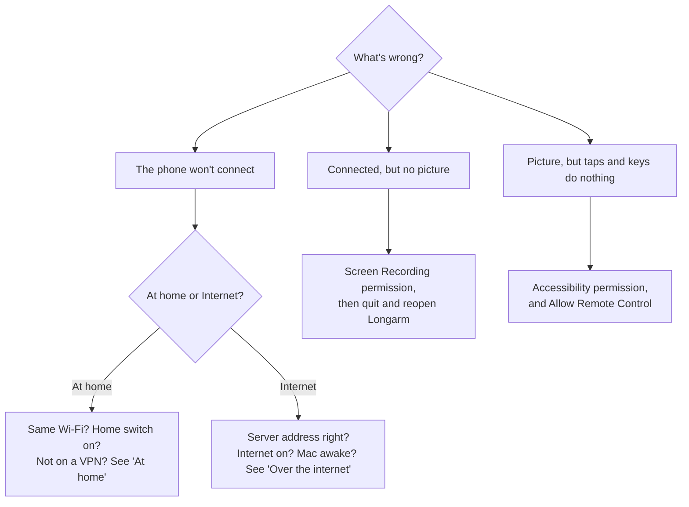

# Troubleshooting

Start with what the phone or the Longarm menu says: most problems name themselves there. If not,
the logs below usually do.

## On the Mac

| Symptom | Fix |
|---|---|
| The phone says **Waiting for the picture…** or shows a Screen Recording message | Allow Longarm in System Settings → Privacy & Security → **Screen & System Audio Recording**, then quit and reopen it. |
| Taps and keys do nothing | Allow Longarm in **Accessibility** (same place). If it's already on after a rebuild, remove it and add it again: ad-hoc-signed builds count as a new app each time (see `LONGARM_SIGN_IDENTITY` in [Getting started](getting-started.md)). |
| **Turn on Allow Remote Control** | It's off: turn it on in the Longarm menu. |
| A key arrives as a shortcut (⌘ or ⌃ with it) | A modifier is held on the phone's rail: ⌘ ⌥ ⌃ ⇧ are highlighted while held, and apply to the next key. Tap it to release. |
| The keyboard button never shows the orange dot in Chrome or Electron apps | They describe their text fields only after being asked; switch away and back to the app once. |

## At home

| Symptom | Fix |
|---|---|
| **Looking for …** forever | Phone and Mac on the same Wi-Fi network (not a guest network that isolates devices). **Connect from → Home Wi-Fi** on. Longarm allowed on the local network (macOS asks the first time). |
| Works on USB, not Wi-Fi | A firewall or VPN on the Mac. Connections arriving through a VPN are refused by design: home means the Mac's own network. |
| Over USB | Run `adb reverse tcp:47900 tcp:47900` again after reconnecting the cable. |

## Over the internet

| Symptom | Fix |
|---|---|
| **This phone doesn't know where to find … over the internet yet** | Set **Internet Server…** on the Mac, then pair again (the link now carries the server) or connect once **At home**. |
| **Can't reach `<host>`** | The phone can't reach your server. Check the address in the Mac's menu, that `https://<host>/health` answers `ok`, and that the phone is online. If you changed servers, the phone still has the old one: connect once **At home**, or pair again. |
| **… is offline** | The Mac isn't signed in to the server: Longarm running, **Connect from → Internet** on, the Mac awake, and the menu showing **Ready**. |
| **… didn't accept this phone** | The pairing link is from before a **Reset Pairing**: get a fresh link or QR code. |
| **Wrong code** / **Too many wrong codes** | The join code set on the Mac. After five wrong tries, internet joins are locked for 15 minutes. |
| Works on Wi-Fi, fails on mobile data or strict networks | The connection needs your relay, and it can't be reached. Open UDP and TCP **3478** and UDP **49160–49200** in your cloud provider's firewall and on the VM (see [deploy/README](../deploy/README.md)). |
| **Reconnecting…** often | A weak network. It recovers by itself; the pill at the top says whether it's **Direct** or through the **Relay**. |

## Dictation

| Symptom | Fix |
|---|---|
| **Add a Deepgram API key** | Longarm menu → **Deepgram API Key…** |
| **The API key was rejected** | The key is wrong or has run out of credit: check it at [console.deepgram.com](https://console.deepgram.com). |
| Nothing is heard | Allow the microphone for Longarm on the phone. |

## Logs

| Where | How |
|---|---|
| Mac | `~/Library/Logs/Longarm/longarm.log`: connections, joins, paths (direct or relay), video rates, errors |
| Phone | `adb logcat -s Longarm` (plus `org.webrtc.Logging` for internet connections) |
| Server | `journalctl -u longarm-rendezvous -u coturn -f` on the VM |

When reporting a bug, the Mac log around the time it happened is the most useful thing to include.
